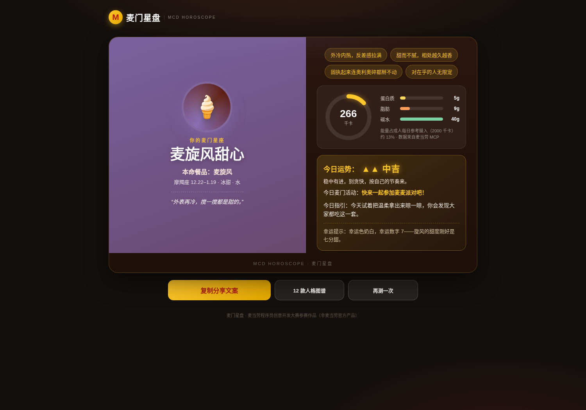
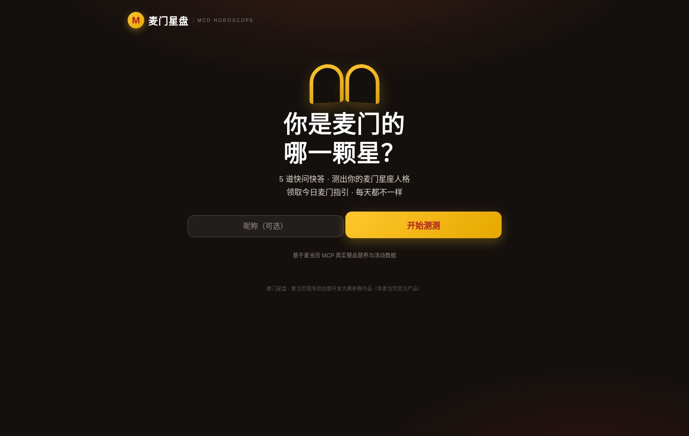
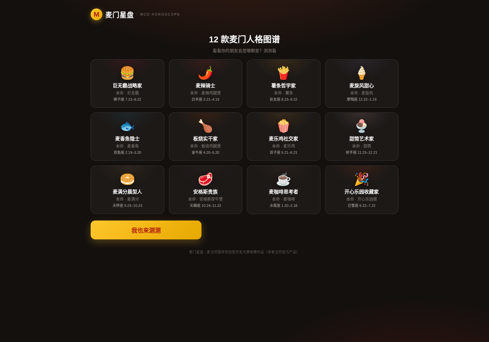

<div align="center">

# 麦门星盘 · MCD Horoscope

**测出你的麦门星座人格，领取今日麦门指引**

5 道快问快答 · 12 款人格 · 基于麦当劳中国 MCP 真实餐品营养与活动数据

   

</div>

---

## 🚀 在线体验

点开即玩，无需安装任何环境（真实麦当劳 MCP 数据实时运行）：

<p align="center">
  <a href="https://wkgmqfqrspzh.cloud.sealos.io">
    
  </a>
</p>

> 在线版已配置麦当劳 MCP 真实 Token（仅存于云端环境变量，代码零泄漏）。想自己跑一遍完整流程，见下方「快速开始」。

---

## 产品截图

<p align="center">
  
</p>

<p align="center">
  
  
</p>

*左侧：首页 · 右侧：12 款人格图谱（图中为真实 MCP 数据运行效果）*

---

## 这是什么？

麦门星盘是一款**有梗、好玩、每天都有新内容**的麦门人格测试 Web 应用：

- **12 款麦门星座人格**：巨无霸战略家、麦辣骑士、薯条哲学家、麦旋风甜心……每款人格都有专属图腾、主题色、性格标签与幸运提示，对应 12 个经典餐品与黄道十二宫；
- **真实数据打底**：人格卡上的营养信息来自麦当劳 MCP 的 `list-nutrition-foods` 工具——能量环形图 + 蛋白质/脂肪/碳水占比条，全部真实可查；
- **今日麦门指引**：结合麦当劳 MCP 的 `campaign-calendar` 活动日历，生成当天运势（大吉/中吉/小吉）、幸运活动与行动建议——每天测，结果都不同；
- **12 款人格图谱**：一次看全所有麦门人格，分享传播的天然钩子；
- **一键分享**：结果是一张可截图的精美卡片 + 一段可复制的分享文案，天然适合发朋友圈、小红书、即刻。

一句话：**它不是算命，是麦门给你的一天好心情。**

## 功能特性

| 功能 | 说明 |
|---|---|
| 麦门星座人格测试 | 5 题快问快答，确定性算法，12 款人格可复现（1024 种答案组合全覆盖） |
| 人格图腾与主题色 | 每款人格独立 emoji 图腾 + 专属主题色，结果卡整体随人格换肤 |
| 真实营养卡片 | 本命餐品能量环形图（占每日参考摄入百分比）+ 蛋白/脂肪/碳水占比条，来自 MCP 实时数据 |
| 今日麦门指引 | 运势（大吉/中吉/小吉，带等级光晕）+ 幸运活动 + 行动建议，联动活动日历 |
| 12 款人格图谱 | 全人格浏览视图，桌面 4 列 / 移动 2 列网格 |
| 分享文案 | 一键复制，带人格图腾、称号与今日运势 |
| 桌面响应式 | 桌面双栏结果卡 / 双列选项；移动端单栏流畅体验 |
| 无 Token 演示模式 | 未配置 Token 时自动使用内置模拟数据，clone 即可完整体验 |
| 零依赖 | 仅用 Node.js 内置能力，`node server.js` 直接运行 |

## 快速开始

### 环境要求

- Node.js **18 或更高版本**（内置 `fetch`，本项目零第三方依赖，无需 `npm install`）

### 1. 克隆并启动（演示模式）

```bash
git clone https://github.com/odin1024/mcd-horoscope.git
cd mcd-horoscope
node server.js
```

打开浏览器访问 `http://localhost:3000`，即可完整体验（此时使用内置模拟数据，界面会显示"演示模式"徽标）。

### 2. 接入真实麦当劳 MCP

从 [麦当劳 MCP 官方平台](https://open.mcd.cn/mcp) 登录并激活申请 MCP Token（此 Token 代表您的麦当劳会员身份，请严格保管）。

```bash
export MCD_MCP_TOKEN=你的Token
node server.js
```

服务启动日志会显示 `REAL（真实麦当劳 MCP）` 模式。此时人格卡营养数据与今日活动均来自麦当劳官方实时接口。

> 安全提醒：请通过环境变量传入 Token，**切勿**把 Token 写入代码、配置示例或提交到仓库。

## 真实使用麦当劳 MCP

| MCP 工具 | 用途 | 在本项目中的作用 |
|---|---|---|
| `list-nutrition-foods` | 查询常见餐品营养成分 | 人格卡展示本命餐品的能量/蛋白质/脂肪/碳水（环形图 + 占比条） |
| `campaign-calendar` | 查询当月营销活动日历 | 生成"今日麦门指引"的幸运活动与运势素材 |

完整的接入地址、协议、调用流程与安全边界见 [MCP_INTEGRATION.md](./MCP_INTEGRATION.md)。

## 测试

```bash
node --test test/*.test.js
```

覆盖：人格算法确定性、全部 1024 种答案组合的可达性、TOON 营养解析、活动日历解析、指引生成与 mock 客户端。当前 **25/25 全部通过**。

## 项目结构

```text
.
├── CONTEST_DECLARATION.md   # 官方参赛声明（内容不可修改）
├── MCP_INTEGRATION.md       # 麦当劳 MCP 集成说明
├── mcp-config.example.json  # 脱敏 MCP 配置示例（仅环境变量占位符）
├── docs/                    # README 配图（真实 MCP 数据运行截图）
├── examples/
│   └── mock-data.json       # 无 Token 演示用模拟数据
├── public/                  # 前端页面（零外部依赖，移动端优先 + 桌面响应式）
├── src/
│   ├── mcp-client.js        # 零依赖 MCP Streamable HTTP 客户端
│   ├── oracle.js            # 营养/活动解析 + 今日指引生成
│   └── persona.js           # 12 款麦门星座人格与测试算法
├── test/                    # 自动化测试（node --test）
└── server.js                # HTTP 服务入口
```

## 安全边界

- 不在仓库、配置示例、命令脚本中保存任何真实 Token、手机号、地址等个人信息；
- 未配置 Token 时自动进入演示模式，不会发起任何外网请求；
- 本项目**只读**使用麦当劳 MCP 的营养与活动查询能力，不涉及领券、下单、支付等写操作；
- 营养信息仅供娱乐参考，不构成医疗或营养建议；餐品与价格以麦当劳官方实时结果为准。

## 📮 反馈与联系

用起来有想法、遇到问题，或想要更多麦门玩法？欢迎扫码关注公众号 **知白守黑** 私信我，每条反馈都会认真看 👇

<p align="center">
  
</p>

## License

[MIT](./LICENSE)

---

本项目是 **麦当劳程序员创意开发大赛** 参赛作品，由参赛者独立开发，**非麦当劳官方产品**。
